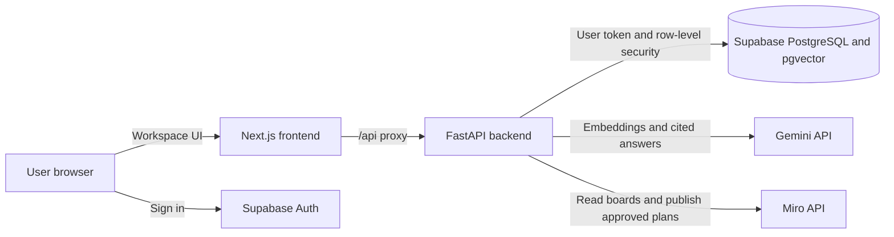

# Mirova

Mirova is a simple RAG project built with Miro and Gemini. It helps teams turn board ideas and research into cited answers and project plans.

## What does it do?

Mirova imports text from Miro boards and research documents, indexes it, then retrieves relevant passages to ground Gemini’s answers. Teams can explore findings, discuss them, and prepare plans for review.

## Main features

- Import and sync text from authorized Miro boards.
- Upload PDF, DOCX, TXT, Markdown, and CSV files.
- Ask questions and inspect clickable source citations.
- Explore research themes, gaps, and possible conflicts.
- Save chats and collaborate through shared workspaces, comments, and tasks.
- Draft roadmaps with owners and deadlines; approve them before publishing sticky notes and connectors to Miro.

## Tech stack

- **Frontend:** Next.js 16, React 19, TypeScript, Tailwind CSS 4, custom CSS.
- **Backend:** Python 3.12, FastAPI, Uvicorn.
- **AI:** Gemini for answers and embeddings.
- **Data and authentication:** Supabase Auth, PostgreSQL, pgvector.
- **Integrations and documents:** Miro REST API, pypdf, defusedxml.

## Architecture

Next.js serves the interface and proxies `/api` requests to FastAPI. Supabase Auth signs users in; FastAPI verifies their token and accesses workspace data under Supabase’s row-level security policies.



## Use cases

Mirova is useful when teams need to connect visual brainstorming with research and move from evidence to action. For example, teams can:

- Summarize a workshop or meeting.
- Find themes and unanswered questions across research.
- Answer product discovery questions with source citations.
- Coordinate work with shared comments, tasks, owners, and deadlines.
- Publish an approved roadmap to a Miro board.

## How to run it

You need Node.js 24 and Python 3.12.

1. Install dependencies:

   ```powershell
   npm ci
   python -m venv backend/.venv
   backend/.venv/Scripts/python -m pip install -r backend/requirements-lock.txt
   ```

2. Copy `.env.example` to `.env.local` and `backend/.env.example` to `backend/.env`. Configure Supabase, Gemini, and Miro in `backend/.env`; keep provider secrets out of frontend configuration.

3. For a new Supabase project, apply `supabase/schema.sql` and `supabase/collaboration.sql`. Set the authorized Miro user and board allowlists in `backend/.env`.

4. Start the app:

   ```powershell
   npm run dev
   ```

   Open [http://localhost:3000](http://localhost:3000). For the isolated demo, run `npm run dev:demo` and open [http://localhost:3001](http://localhost:3001).
